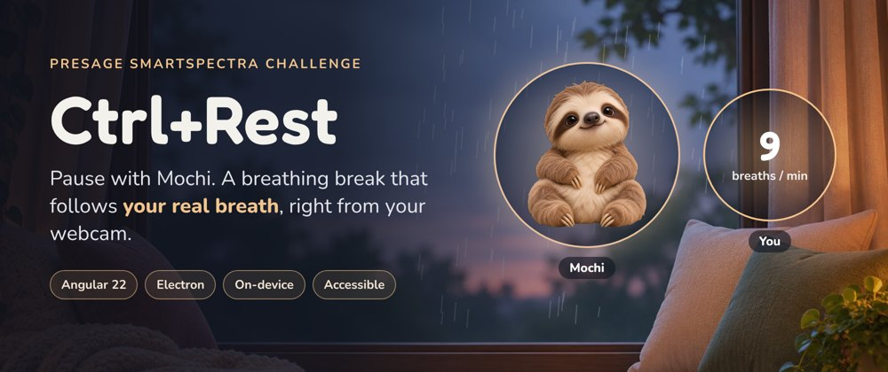
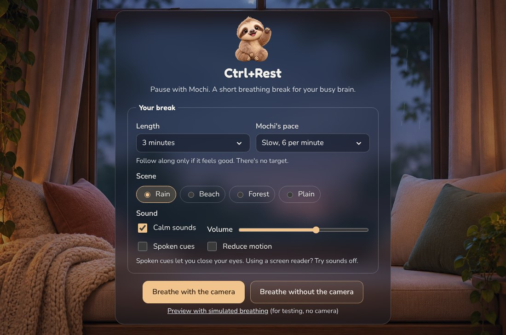
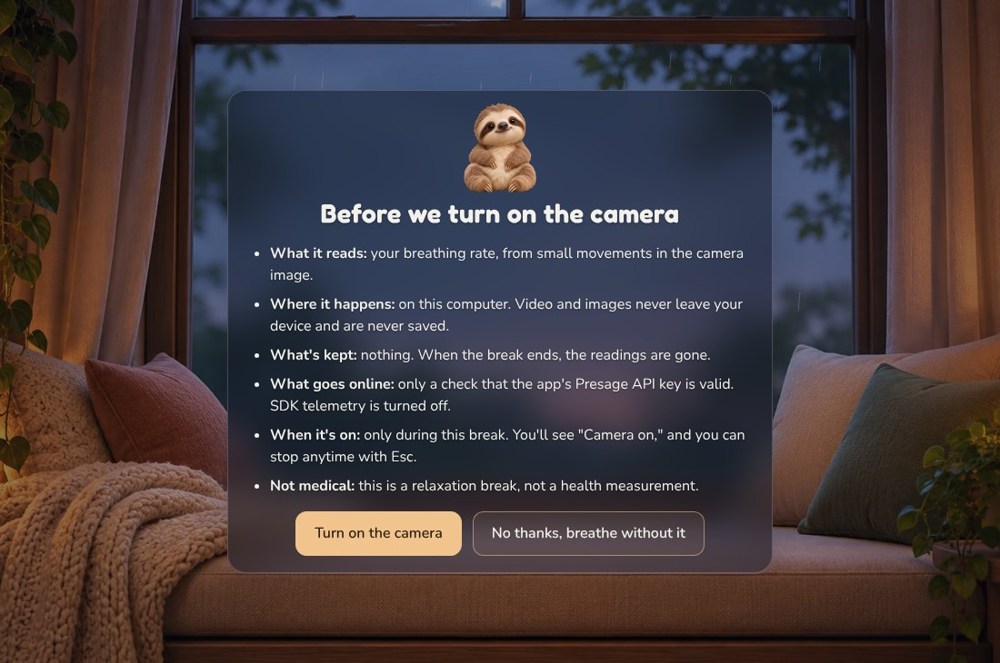
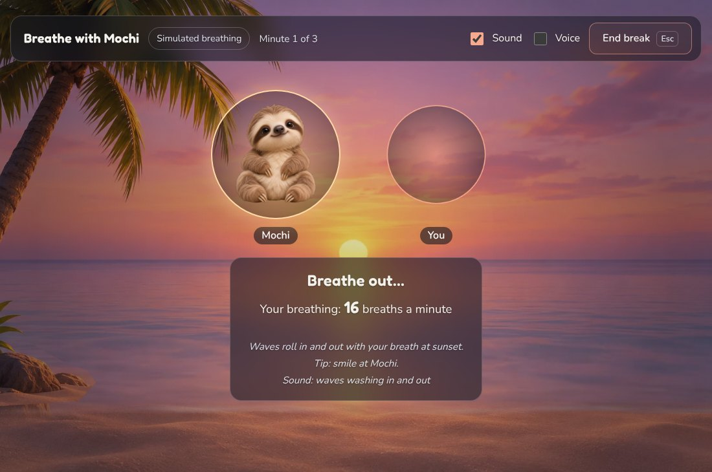
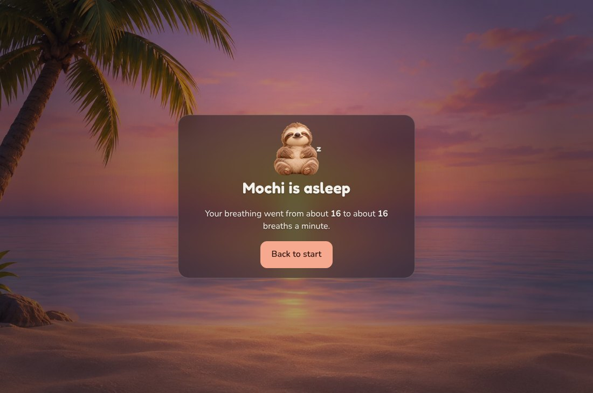

# Ctrl+Rest 🦥

**Pause with Mochi.** A short breathing break for developers. Mochi the sloth breathes slowly on screen. If you choose to turn on the camera, a second circle follows your real breathing rate, measured on your own computer with the [Presage SmartSpectra SDK](https://smartspectra.presagetech.com/docs/), and the whole scene breathes with you.

Built with Angular 22 (zoneless, signals) inside Electron for the [DEV Presage SmartSpectra SDK Challenge](https://dev.to/challenges/presage-2026-11-04).

> Ctrl+Rest is a relaxation break, not a medical device. It doesn't diagnose, treat or monitor anything.

**Demo video:** [Watch Ctrl+Rest in action on YouTube](https://studio.youtube.com/video/7dRqiNo8VCk)

| Start | Consent | Break | Mochi is asleep |
| --- | --- | --- | --- |
|  |  |  |  |

## What it does

- **Breathe with Mochi:** pick a break length (2, 3 or 5 minutes) and Mochi's pace (5 to 10 breaths a minute). There's no target. Follow along only if it feels good.
- **With the camera (after consent):** your live breathing rate shows next to Mochi's, your camera view sits inside your breathing circle, and friendly hints help you sit in frame ("Move a little closer").
- **Scenes that breathe with you:**
  - **Rain:** rain falls on the window glass and softens as your breathing slows.
  - **Beach:** the water slides up the sand when you breathe in and back when you breathe out.
  - **Forest:** sunlight glows with each breath while leaves drift down.
  - The lights dim slowly as the break goes on.
- **Calm sounds, made in code** (Web Audio, no audio files): rain that softens, waves that swell on the inhale, a breeze with birds that quiet down as you settle.
- **Spoken cues (optional):** "breathe in… breathe out" in your computer's own voice, with a voice picker.
- **Smile at Mochi:** the SDK notices when you smile, and Mochi waves back with a few hearts.
- **Mochi:** she waves hello, blinks, breathes from her belly, nods off near the end and falls asleep. The summary shows how your breathing changed ("from about 16 to about 9 breaths a minute"), and the camera turns off.

## How it uses SmartSpectra

| Signal | What Ctrl+Rest does with it |
| --- | --- |
| **Breathing rate** (`metrics.breathing.rate`, shown once the SDK marks it `stable`) | Your circle's pace, the number on screen, how hard it rains, the waves, the forest light, the sound, and the end summary |
| **Facial expressions** (`MetricType.EXPRESSIONS`, `HAPPY` score) | Mochi waves back when you smile (at most every 8 seconds) |
| **Validation status** (`validationStatus` codes) | Plain-language framing hints, shown and optionally spoken |

The code:

- `src/app/breath.service.ts` wraps the renderer SDK: options, events, decoding metrics, friendly errors, smile detection, and a simulated mode.
- `electron/main.cjs` calls `bindSmartSpectraIpc`.
- `electron/preload.cjs` loads the SDK preload bridge.

The breathing rate is a 30-second average, so the first reading takes about 30 seconds, and every animation eases toward new values so nothing jumps.

## Accessibility

Built in from the start, not added at the end:

- Everything works with the keyboard. **Esc** ends a break anytime.
- Focus moves to each new screen's heading. Screen readers hear framing hints and the breathing rate (throttled so it isn't chatty) and the smile reaction.
- **Reduce motion** (follows your OS setting, plus a toggle) stops every animation.
- Captions say what's moving in the scene and what sound is playing. Sound and voice each have their own switch.
- Spoken cues let you close your eyes or use it without the screen.
- Text contrast is checked on every scene. Nothing flashes.
- No-camera mode for anyone who'd rather not use a camera.
- Gentle wording, no scores, and Mochi's pace is a suggestion, never a goal (important for people with asthma or other breathing conditions).

## Consent and data handling

- **Camera consent:** the camera never turns on until you choose "Breathe with the camera" and confirm on the consent screen. It's on only during that break, a "Camera on" label is always visible, and Esc ends it immediately. The app only grants camera access to its own bundled page.
- **On-device processing:** SmartSpectra measures breathing (and, for the smile reaction, facial expressions) on your computer. Video frames and images are never saved or sent anywhere.
- **Storage and retention:** no readings are stored. They live in memory for the current break and are gone when it ends. There's no account, database or history. The app only remembers your settings (scene, volume, voice) in local storage.
- **Sharing:** none.
- **What goes online:** only the SDK's check that your Presage API key is valid.
- **SDK telemetry:** turned off (`enableTelemetry: false`).
- **AI services:** none. Sounds are generated in code and spoken cues use your computer's built-in voices.
- **Deletion:** there are no readings to delete. Removing your key from `.env` turns camera mode off.

## Requirements

- Node.js 20 or newer
- A Mac with **Apple Silicon** (M1 or newer), Windows 10/11 x64, or Linux x64/arm64 (Ubuntu 22.04+). Intel Macs aren't supported by the SDK.
- A webcam
- A free Presage API key for camera mode: [physiology.presagetech.com](https://physiology.presagetech.com/auth/register)

## Setup

```bash
git clone https://github.com/tmott13/ctrl-rest.git
cd ctrl-rest
npm install          # also downloads the SDK runtime (a few hundred MB)
cp .env.example .env # then paste your key after PRESAGE_API_KEY=
npm run app          # builds the Angular app and opens Ctrl+Rest
```

`.env` is git-ignored. Never commit your key.

### Try it without a camera or key

Click **Preview with simulated breathing** on the start screen. It runs the whole flow with a simulated breathing rate, including a simulated smile at 20 seconds.

### Development

- `npm run dev` rebuilds on save. Reload the window with Cmd+R or Ctrl+R.
- `npm start` runs the Angular app in a normal browser. Camera mode needs Electron, but the no-camera and simulated breaks work there.

## Troubleshooting

| Problem | Fix |
| --- | --- |
| No "Breathe with the camera" button | Add your key to `.env`, then restart with `npm run app` |
| "Your Presage API key was not accepted" | Check the key in `.env` for typos or extra spaces |
| Camera doesn't turn on (macOS) | System Settings → Privacy & Security → Camera, then allow Ctrl+Rest (or Electron when running from source) |
| The voice sounds robotic | Download a Premium or Enhanced voice: System Settings → Accessibility → Spoken Content → System voice → Manage Voices, then restart the app |
| First reading is slow | That's expected. The breathing rate is a 30-second average |

## Project layout

```
electron/main.cjs           Electron window, camera permission, SmartSpectra IPC bridge, app icon
electron/preload.cjs        SmartSpectra preload + a tiny getApiKey() bridge
src/app/breath.service.ts   SDK wrapper (camera), smile detection, simulated mode
src/app/scene.ts            Animated scenes (rain, beach, forest) driven by your breathing
src/app/sound.service.ts    Calm sounds generated with Web Audio
src/app/voice.service.ts    Spoken cues with the system's voices
src/app/app.*               The screens: start, consent, break, done
public/                     Mochi art, scene backgrounds, rain window mask, favicon
build/icon.png              App icon
```

## Credits

- Mochi and the scene backgrounds were made with ChatGPT image generation.
- Fonts: Fredoka (headings) and Nunito (body), SIL Open Font License, bundled through Fontsource so the app makes no web requests for them.
- [Presage SmartSpectra SDK](https://smartspectra.presagetech.com/docs/) for on-device breathing and expression signals.

## License

MIT for this project's code. The SmartSpectra SDK is © Presage Technologies and has its own license.
